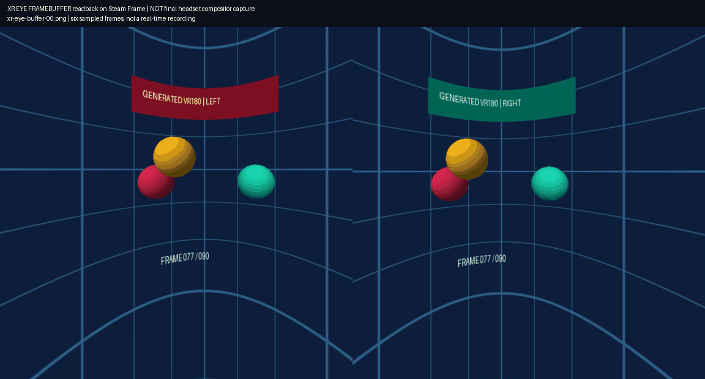
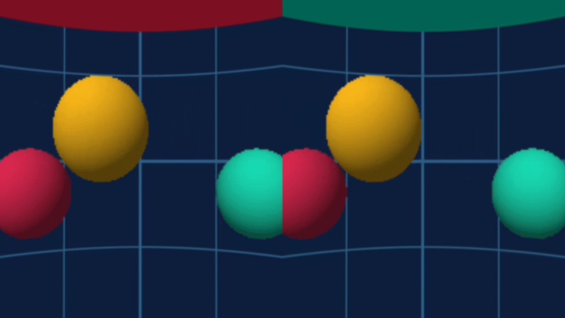

# Technical notes

What we found getting WebXR working on the Steam Frame, for anyone picking
this up or taking it upstream. Tested with Chromium 156.0.8071.0 (arm64),
SteamOS 0.3.0 (build 20260922.6101926) and SteamVR 2.17.10.

## Why stock Chromium on Linux has no immersive WebXR

Chromium 154 was the first release to compile OpenXR on Linux
(`enable_openxr` includes Linux). But
`content/services/isolated_xr_device/xr_runtime_provider.cc` only creates an
OpenXR device when `ENABLE_OPENXR && IS_WIN`. Nothing on Linux calls the
OpenXR code, so the linker drops it. Flathub's arm64 Chromium contains no
OpenXR loader code at all, and flags such as `--force-webxr-runtime=openxr`
can't bring it back.

Two Gerrit changes fill that gap. Both have merged, and the first release
with both is 157.0.8088.0 (Canary):

- [CL 8132979](https://chromium-review.googlesource.com/c/chromium/src/+/8132979)
  creates the OpenXR device on Linux, using the Vulkan graphics binding
  (`XR_KHR_vulkan_enable2`). `device::features::kOpenXR` stays off by
  default, so it needs `--enable-features=OpenXR`.
- [CL 8441736](https://chromium-review.googlesource.com/c/chromium/src/+/8441736)
  runs the XR device service in its own sandbox (`xr_compositing`, with the
  `XrProcessPolicy` seccomp policy and a file broker), instead of requiring
  `--no-sandbox`.

The notes below were written against patch set 44 of CL 8132979, before it
merged. Neither problem is fixed upstream yet: the merged XR seccomp policy
still refuses every `getsockopt`, and nothing changes how the broker answers
`/proc/self`.
[CL 8498995](https://chromium-review.googlesource.com/c/chromium/src/+/8498995),
also in 157.0.8088.0, lets the XR sandbox read a Flatpak's GPU drivers; it
matters for the Flathub Chromium, not for this build.

## The SO_PEERCRED crash

With both CLs, the XR utility process crashed inside `xrCreateInstance` on
system call 0xd1 (`getsockopt` on arm64). SteamVR's IPC client calls
`getsockopt(fd, SOL_SOCKET, SO_PEERCRED, …)` to check which process is on the
other end of its socket, and `XrProcessPolicy` refuses every `getsockopt`.
[`patches/0001-xr-sandbox-allow-getsockopt-SO_PEERCRED.patch`](../patches/0001-xr-sandbox-allow-getsockopt-SO_PEERCRED.patch)
allows exactly `SOL_SOCKET`/`SO_PEERCRED` and still returns `EPERM` for
everything else.

## Why the seccomp filter is still off

With the patch, `xrCreateInstance` gets further but fails with
`Unable to init path manager: VRInitError_Init_Internal`. SteamVR's client
reads `/proc/self/status` to find its own process ID. Inside the seccomp
sandbox, file opens go through Chrome's broker process, so `/proc/self` is
the broker's, and SteamVR registers the broker's PID instead of the XR
process's. Granting the broker `/proc/self` doesn't help, because the broker
can only answer for itself.

Fixing this properly needs a change in Chromium: for example, having the
broker client rewrite `/proc/self` to `/proc/<caller pid>`, or opening the
needed `/proc` files before the sandbox seals. Until then the launcher passes
`--disable-seccomp-filter-sandbox`. The namespace sandbox still works:
SteamOS allows unprivileged user namespaces, so the setuid `chrome_sandbox`
isn't needed.

## What a working session looks like

- The page's `isSessionSupported("immersive-vr")` resolves `true`.
- After the **Allow VR?** prompt, `requestSession("immersive-vr")` succeeds.
  The first frame has a viewer pose with 2 views and a 2880 × 1440 framebuffer
  (1440 × 1440 per eye).
- SteamVR's log (`~/.local/share/Steam/logs/vrserver.txt`) shows the app move
  from `VRApplication_OpenXRInstance` to `VRApplication_OpenXRScene`, followed
  by controller binding files being created for
  `system.generated.openxr.chromium 156.chrome`.
- If nobody is wearing the headset, SteamVR keeps it in standby: the session
  stays at `XR_SESSION_STATE_SYNCHRONIZED`, the page sees
  `visibilityState: "hidden"`, and only the first frame runs. Put the headset
  on to see it.

## Input and frame rate (2026-09-27)

Measured with a session that clears to red, with `hand-tracking` and
`local-floor` requested:

- **Frame rate:** 72 fps. Over 16.6 s the median frame interval was 13.9 ms,
  p99 14 ms and max 14 ms, with no frame longer than 1.5× the median.
  SteamVR's `vrcmd --stats` counted 2,940 submits, 4 dropped frames (all at
  startup) and 2 reprojected.
- **Controllers:** the right controller appears as a `tracked-pointer` input
  source with profiles `oculus-touch` and
  `generic-trigger-squeeze-thumbstick`, an `xr-standard` gamepad (7 buttons,
  4 axes), a grip space, and a 25-joint `hand`. Its target-ray and grip
  poses were available on every frame, and not emulated. A physical squeeze
  produced `squeezestart`/`squeeze` events and set button 1 as pressed.
- **Not covered:** trigger (`select`), thumbstick axes, face buttons, the left
  controller (not connected during the test) and bare-hand tracking.
- **Haptics:** `gamepad.hapticActuators` is empty, so pages can't vibrate
  the controllers.
- Requesting `hand-tracking` makes Chromium ask **Allow hand tracking?** in
  the browser panel before the session starts.

## Graphics

Chromium's GPU process uses ANGLE on OpenGL, which runs on zink over the
Turnip Vulkan driver (Adreno 750). Chromium's own Vulkan backend stays off;
that doesn't stop the session. The OpenXR runtime uses Vulkan.

## Video decoding

Most VR180 and 360 video on the web is HEVC (H.265). Chromium on Linux has
no software HEVC decoder; it decodes HEVC only on a hardware decoder. Without
one, an HEVC video plays its sound but shows no picture: the element raises
no error and `currentTime` advances, but `videoWidth` stays 0 and no frames
are decoded. `canPlayType()` and `MediaSource.isTypeSupported()` report
HEVC as unsupported, so players that check pick another format, but many VR sites
serve HEVC without checking.

Verified on 2026-10-23 (BUILD_ID 20261015.6141207) with the Chromium 156
build, which had no hardware decoder: H.264 (up to 5760 × 2880) and VP9
played with frames, while HEVC 1080p, HEVC Main 10 4K and HEVC 7680 × 3840
played sound with 0 decoded frames.

The Frame's decoder is Qualcomm's `iris` V4L2 driver at `/dev/video-dec0`
(`/dev/video22`), a stateful decoder for H.264, HEVC and VP9 from 128 × 128
up to 8192 × 8192. The Frame has no VA-API driver. Steam's own browser
(`steamwebhelper`) runs with `--enable-features=PlatformHEVCDecoderSupport,V4L2VideoDecode`,
so Valve uses this decoder too.

So the build sets `use_v4l2_codec = true` and `use_vaapi = false`, the same
pair as upstream's `linux-v4l2-codec-rel` try builder. On desktop Linux,
Chromium looks for V4L2 decoders at `/dev/video0` to `/dev/video255`.
Hardware decoding is off by default in a build without VA-API, so the
launcher adds `AcceleratedVideoDecoder` to `--enable-features`.

The flags alone aren't enough. The Frame's decoder is stateful (it parses
the bitstream itself), so Chromium uses `V4L2StatefulVideoDecoder`, the
decoder written for Qualcomm Chromebooks. At 157.0.8088.0, and on `main`
in October 2026, its `Decode()` returns `kUnsupportedCodec` for HEVC, even
though the device's HEVC profiles are listed as supported.
`patches/0002-v4l2-stateful-decoder-hevc.patch` handles HEVC the way the
decoder handles VP9: each `DecoderBuffer` goes to the driver as it is.
That works because `VideoDecoderPipeline` already converts HEVC to Annex B
(`needs_bitstream_conversion_`), and media playback hands over one whole
frame per buffer, which stateful drivers need. H.264 goes through a
reassembler instead, because some sources split its frames. The patch also:

- gives HEVC 16 input buffers, as H.264 has, and requests 16 MiB buffers
  above 4K (upstream requests 4 MiB above 1080p, and an 8K keyframe can be
  larger). The driver may still allocate less.
- fails the decode when a frame is larger than its input buffer. Upstream
  `CHECK`s the size, which crashes the GPU process.
- leaves single-plane P010 out of the output formats. Chromium can't lay it
  out yet: the first decoded 10-bit frame would fail a `CHECK`. (The
  Frame's decoder doesn't offer P010 anyway; for 10-bit HEVC it offers only
  Q10C, see below.)
- reports a decode error when the decoder can't set up its output (for
  example, no usable output format) or a frame doesn't fit, and fails later
  decodes until the player resets. The decoder reports errors only through
  its decode callbacks, so upstream left playback waiting silently in these
  cases.
- stops offering HEVC Main 10 and VP9 profile 2 from V4L2 decoders that
  take whole frames (stateful ones, like the Frame's). See below.

**Chromium's V4L2 path on this Frame, verified 2026-10-23.** Steam's own
Chromium, `cefsimple` from `~/.local/share/Steam/steamrtarm64` (CEF on
Chromium 126), ran the codec probe with
`--enable-features=PlatformHEVCDecoderSupport,V4L2VideoDecode`. Results:

| Clip | Result |
|---|---|
| HEVC 1920 × 1080 | 152 frames decoded |
| HEVC 7680 × 3840 | 113 frames in 3.8 s |
| H.264, VP9 | decoded |
| HEVC Main 10 3840 × 2160 | failed to decode (`Failed to pick an output format`) |

For 8-bit streams the driver offers Q08C, NV12 and NV21 as output. For
10-bit HEVC it offers only Q10C, Qualcomm's compressed 10-bit format, which
Chromium can't use. Asking it for NV12 anyway (`ffmpeg -c:v hevc_v4l2m2m`)
gives frames with the right shapes but wrong colours. So 10-bit HEVC can't
play on this decoder in Chromium.

Chromium 126 still said `canPlayType()` "probably" for HEVC Main 10. A
player that trusts that would pick 10-bit HEVC over an H.264 copy and show
nothing. So the patch stops offering HEVC Main 10, and players fall back.
VP9 profile 2 goes to Chromium's software VP9 decoder.

**Chromium 157 device verification, 2026-10-24.** Both CI runs
[39916971445](https://github.com/saphid/chromium-webxr-steam-frame/actions/runs/39916971445)
and [39934948705](https://github.com/saphid/chromium-webxr-steam-frame/actions/runs/39934948705)
succeeded. Run B's artifact was installed with the existing laser-touch
launcher retained and `AcceleratedVideoDecoder` added.

The probe needs `DISPLAY=:0` and `--enable-gpu` with `--headless`; otherwise
it uses a software GPU and doesn't expose HEVC. With hardware available,
run B advertises 8-bit HEVC and rejects Main 10 as intended, but fails to
allocate the input queue: `VIDIOC_REQBUFS` returns `EINVAL`. Upstream's
stateful decoder calls `SetFormat()` with `gfx::Size()` (0 × 0). A native
ioctl probe reproduced the failure for both H.264 and HEVC at every tested
buffer count (2, 4, 8, 16); supplying 1920 × 1080 made all allocations pass.

`0003-v4l2-stateful-coded-size.patch` passes `config.coded_size()` instead.
A temporary diagnostic shim that supplied nonzero dimensions decoded HEVC
1080p (150 frames) and 7680 × 3840 (91 frames); Main 10 remained unsupported.
That diagnostic used `--no-sandbox --in-process-gpu` so the shim could reach
the ioctl call; it is evidence for the size mismatch, not verification of
the rebuilt browser under its normal process setup. Neither flag nor the
shim is in the installed launcher. The source patch applies cleanly on top
of patch 0002. Run B's headless GPU probe also returned
`navigator.xr.isSessionSupported("immersive-vr") === true` under the normal
process sandbox setup. An immersive session and a real VR180 site still
need testing.

**Corrected build installed and verified, 2026-10-24.**
[Run 40060061894](https://github.com/saphid/chromium-webxr-steam-frame/actions/runs/40060061894)
at [f586f00](https://github.com/saphid/chromium-webxr-steam-frame/commit/f586f00227d6fb1afe26c44e28991f17cb069ea1)
succeeded. Artifact 12547641202 was 146,203,864 bytes, with SHA-256
`771b849b76bd0ba133e826e1fad289b2d3e68cb7ac55589953e221cd5af4019e`,
verified against GitHub's metadata before installation. The existing
laser-touch/systemd launcher was retained byte-for-byte with
`OpenXR,AcceleratedVideoDecoder`; Steam shortcut 2349681812 and the original
156 binary/launcher rollback copies were preserved.

A normal, separate-process browser on `DISPLAY=:0 --ozone-platform=x11`
passed the clip probe with no shim, `--no-sandbox`, or `--in-process-gpu`:

| Clip | Dimensions | Decoded frames | Decode error |
|---|---|---|---|
| HEVC Main | 1920 × 1080 | 152 | none |
| HEVC Main | 7680 × 3840 | 131 | none |
| H.264 | 1920 × 1080 | 151 | none |
| H.264 | 5760 × 2880 | 145 | none |
| VP9 | 1920 × 1080 | 152 | none |

A second pass drew decoded HEVC frames into a canvas: 1080p decoded 150
frames and 8K decoded 139, with no errors and thousands of distinct sampled
colours. The 8K capture was visually checked against a software-decoded
ffmpeg frame from the same clip. The corrected build also returned
`{"xr":true,"immersiveVR":true}` in a separate normal-browser WebXR probe.
Immersive VR180 results and the remaining headset-visibility limit are recorded below.

[Machine-readable results](verification/hevc-frame-2026-10-24.json) and the
8K decoded-frame capture:

HEVC Main 10 returned empty `canPlayType()` and false MSE support, as intended.
The probe explicitly pauses each video, clears its source and calls `load()`
before the next clip: merely removing a playing element can retain its decoder
and make the subsequent 8K allocation fail.

Headless mode remains unsuitable for this hardware playback probe. Even with
`DISPLAY=:0 --enable-gpu`, and with explicit GL or X11 selection, it failed
at `MailboxVideoFrameConverter`: no shared-image backing factory, followed
by a GPU restart. These failures are retained as evidence, not counted as
successful playback. The installed launcher uses the tested normal X11 path.
Raw results and logs are in the owning steam-frame checkout under
`artifacts/chromium-xr-hevc-2026-10-24/`.

A fresh independent review of patch 0003 and its recovery workflow was
attempted through T3 (`claudeAgent`, `claude-opus-5-5`, high effort), but the
review task failed before reviewing because the Claude API rate limit was
reached. No independent review of that correction is claimed.

### Immersive HEVC VR180 test, 2026-10-24

**First run: partial pass.** Hardware decoding, both XR eye buffers and
SteamVR submission passed, but final visible headset playback was unverified.
The follow-up below subsequently verified actual headset pictures and motion. The installed
binary was unchanged. A real `immersive-vr` session started through a valid
button gesture, with a temporary profile and the production X11/features/
seccomp settings. No headless mode, shim, fake XR, `--no-sandbox` or
`--in-process-gpu` was used.

The fixture was a locally generated, looping 7680 × 3840 HEVC Main 8-bit
clip at 30 fps: left/right side-by-side, each eye a 180° equirectangular
hemisphere. It has a synthetic 64 mm stereo baseline, eye labels, grid and
moving spheres. Each eye was ray-traced at 640 × 640 then upscaled, so this
proves the 8K decode dimensions and projection path, not native-detail or
high-bitrate 8K performance. No audio or spatial MP4 metadata; a minimal
WebXR player supplied the stereo projection. The public three.js video
example was inspected but is stereo 360°, so no third-party VR180 site
compatibility is claimed.

- Media events selected `V4L2VideoDecoder` for HEVC 7680 × 3840. Browser
  playback counters recorded 5,545 video frames, 35 dropped and no reported
  decode errors; 5,521 video-frame callbacks fired. These are browser
  playback counters, not an instrumented hardware decode count.
- WebXR rendered 14,848 frames over 207.4 seconds (71.57 mean frames/s), with
  two 1728 × 1728 viewports in a 3456 × 1728 framebuffer. Both eyes were
  drawn on every reported XR frame. Six direct eye-buffer samples showed
  moving video pixels, correct eye labels and distinct stereo views.
- SteamVR independently recorded 14,895 submissions from Chromium's XR
  process. This run included looping and costly readback captures; it is
  not a controlled performance benchmark.
- Actual SteamVR headset screenshots remained uniform dark background.
  Tracking was invalid (`poseValid=false`, result 101 / out of range);
  WebXR returned identity orientation and emulated position. The mirror API
  returned `InvalidTexture`. Invalid tracking co-occurred with the blank
  captures; its role in the failure was not conclusively isolated. Final
  headset visibility, head-motion behavior and subjective viewing remain
  unverified. Repeat that check with the headset tracking in its playspace.

The image below samples the actual XR eye buffers, **not the final headset
compositor output**. It shows six sampled frames, not a real-time recording.

[Machine-readable VR180 result](verification/vr180-frame-2026-10-24.json) ·
[Blank final headset capture](verification/vr180-headset-capture-2026-10-24.png).
Raw evidence is in the steam-frame checkout under
`artifacts/chromium-xr-vr180-2026-10-24/`. The test was performed by T3's
`codex` / `gpt-6-astra` worker (completed); the parent checked raw metrics,
fixture/image hashes and captures. This was runtime verification, not an
independent code review. Owned processes/profile/staging and lock were
cleaned up; the installed binary and launcher hashes were unchanged.

### Final headset picture verified, 2026-10-24

The follow-up verified actual **SteamVR stereo compositor output** using
`IVRScreenshots_001`, distinct from the browser eye-buffer readbacks above.
Two captures at 11:11:24.867 and 11:11:28.998 UTC show the curved grid and
coloured spheres in both eyes, with the yellow sphere in different positions.
Native tracking was valid (result 200) and the dashboard was hidden at both
successful captures. SteamVR submissions increased from 646 to 937.

The same installed binary selected `V4L2VideoDecoder` for the same generated
7680 × 3840 HEVC Main SBS 180° fixture. The final short repeat drew 933 XR
frames per eye; browser counters recorded 370 video frames, 9 dropped and
no playback errors. This confirms picture and sampled motion, not a
controlled frame-rate benchmark. The preceding short session also passed
playback (503 browser video frames, 5 dropped).

Tracking remained intermittent. The player initially centered from an
invalid identity/emulated pose, leaving the scene at the edge of the view
when tracking recovered. The test player was recentered once on a real,
non-emulated pose using its existing rotation algorithm. No runtime pose,
production browser, launcher or persistent profile was modified. Initial
blank/off-center captures are retained in the raw evidence.

This GIF alternates **two still captures at 1 fps**; it is not a real-time
recording or proof of playback smoothness. It supersedes the earlier
final-headset visibility gap for this generated fixture. Third-party site
compatibility, native-detail/high-bitrate 8K performance, sustained tracking
and subjective comfort remain untested.

[Verified headset result](verification/vr180-headset-verified-2026-10-24.json).
Raw evidence: steam-frame `artifacts/chromium-xr-vr180-worn-2026-10-24/`.
The `codex` / `gpt-6-astra` test worker completed; the parent inspected both
final PNGs, checked capture/fixture hashes, raw decoder/tracking/submission
records and cleanup. Dashboard visibility was restored, owned processes and
temporary staging/profile were removed, and the shared-device lock released.
Installed binary and launcher checksums remained unchanged; existing awake
protection and SteamVR processes were preserved.

## Panels and the Steam library

The Frame's compositor (gamescope) gives every Steam app ID its own SteamVR
overlay, named `valve.steam.desktopgame.<appid>`, which appears as a panel in
the headset. A non-Steam shortcut gets an app ID like any game, so launching
Chromium XR from the library gives it a panel. `frame/steam-shortcut.py` adds
the shortcut through the Steam client's DevTools port (`127.0.0.1:8080`,
page `SharedJSContext`) with `SteamClient.Apps.AddShortcut`, so Steam doesn't
need restarting. (`steam steam://addnonsteamgame/<path>` adds nothing.)

Steam preloads its in-game overlay, `gameoverlayrenderer.so`, into everything
it launches through `LD_PRELOAD`. In Chromium it segfaults the zygote during
library initialisation. The GPU process then fails to launch
(`GPU process launch failed: error_code=1002`), and after a few tries
Chromium quits with `GPU process isn't usable. Goodbye.` about 30 seconds
after starting. The `chromium-xr` launcher removes the overlay from
`LD_PRELOAD` before starting Chromium, keeping anything else that was
preloaded.

## Debugging

- **Testing without wearing the headset.** In standby SteamVR keeps the
  session hidden. With `vrcmd` from `/opt/steamvr/bin/linuxarm64`:
  `vrcmd --set-settings-bool power.pauseCompositorOnStandby 0`,
  `vrcmd --set-settings-float power.turnOffScreensTimeout 3600`, then
  `vrcmd --handlewakeup`. The session becomes visible and renders at the
  headset's rate. If it stays `visible-blurred`, the Steam dashboard is open
  over it: run `SteamClient.OpenVR.VROverlay.HideDashboard()` in the Steam
  client's DevTools (`127.0.0.1:8080`, page `SharedJSContext`). Undo with
  `--set-settings-bool power.pauseCompositorOnStandby 1` and
  `--set-settings-float power.turnOffScreensTimeout 5`. (The bool setter
  reads `true` as false; use 1 and 0.) Verified 2026-09-27: a WebXR session
  clearing to red filled both eyes in SteamVR's stereo screenshot.
- If the headset is outside its playspace, SteamVR shows the passthrough
  camera wherever a page leaves transparent pixels.

- `chromium-xr --remote-debugging-port=9223 URL` opens DevTools on the Frame's
  loopback. It has no password, so close the browser when you're done. If a
  VPN such as userspace Tailscale forwards traffic to loopback, other devices
  can reach it.
- `chrome://gpu` and `chrome://webxr-internals` show the graphics setup and
  the XR runtime Chromium picked.
- SteamVR's logs are in `~/.local/share/Steam/logs/`. `vrserver.txt` shows
  the session starting and which app SteamVR bound it to.
